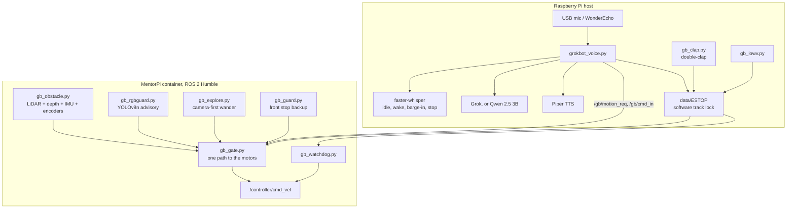

# MentorPi Voice Assistant

Voice-first software for a [Hiwonder MentorPi T1 Advanced](https://www.hiwonder.com/products/mentorpi-t1) tracked rover. A Raspberry Pi 5 listens, talks, and decides. [Grok](https://x.ai/) (xAI) is the conversational brain, with a local Qwen 2.5 3B model on the Pi when the network or the daily budget is unavailable. ROS 2 Humble, already running in Hiwonder's MentorPi container, owns the motors, LiDAR, depth camera, and IMU.

The tree under `grokbot/` matches `~/grokbot` on the robot, so a checkout can be copied into place.


## What it can do

Everything below is implemented in this tree.

**Wake word.** The software phrase is exactly **wake up Wally** (capitalization and punctuation do not matter). **Hello Wally**, **Hey Wally**, and a bare "Wally" are not wakes, including through a fuzzy or anywhere-token match. Older G-Bot phrases still match only when the sentence does not mention Wally. The [WonderEcho Pro](https://docs.hiwonder.com/projects/MentorPi-T1/en/latest/docs/1.getting_ready.html) factory firmware phrase **Hello Hiwonder** is a separate hardware trigger on its serial port. This project does not flash that chip, and a successful software phrase is not a change to the hardware keyword. Spoken acceptance of "wake up Wally" on the robot has not been run from this tree. After the acknowledgement ("Hello John, are you ready to rock and roll?") there is a follow-up window.

**Speech.** Idle listening, the wake phrase, barge-in, and safety phrases are transcribed on the Pi with faster-whisper (default `base.en`). A second Whisper instance listens while the robot is speaking, thinking, or moving, so "stop" is not stuck behind the main loop. Cloud speech-to-text (xAI `grok-voice-transcribe-2.0`) is optional: set `STT_BACKEND=xai`. The default is `local`, including for the command that follows a wake. Speech out is [Piper](https://github.com/rhasspy/piper) (default voice `en_US-lessac-medium`). An xAI TTS voice is available with `TTS_BACKEND=xai`.

**Conversation.** Short spoken answers: lead with the point, plain words, no markdown, and no jokes about motors or sensors. Keyword intents (battery, clock, motion, maps, lights) stay on the Pi and spend no cloud tokens. Small talk goes to local Ollama. Other conversation goes to Grok when `XAI_API_KEY` is set and today's budget remains, otherwise to Qwen 2.5 3B (`qwen2.5:3b`). "Describe what you see" sends a camera frame to Grok vision when the vision budget allows.

**Driving.** Timed voice commands ("drive forward for three seconds", "turn left") go through one motion gate. The gate owns the clock, caps speed (0.12 m/s and 0.8 rad/s by default), and drops the command if messages stop arriving (0.5 s deadman). Driving stays off until `ALLOW_MOTION=1`.

**Explore.** "Map this room and come back", "drive two metres and come back", and "drive around for two minutes" are camera-first wanders. The rover slows and turns around obstacles using the fused depth and LiDAR view, then picks a different recovery if the last one bumped. Nav2 can be started as well (`EXPLORE_NAV2=1`) but is off by default, and its velocity is remapped so it cannot write `/controller/cmd_vel` itself. A request to drive to a named place is answered in speech: that hookup is not in this tree. Hiwonder's own line-follow, colour-track, gesture, and LiDAR apps are recognized and left switched off unless `ALLOW_STOCK_DRIVE=1`, because those nodes publish velocity outside the gate.

**Mapping.** "Start mapping" / "save the map" launches Hiwonder's slam_toolbox include (`slam_base.launch.py` only, so the camera and LiDAR drivers are not started twice). Mapping itself does not drive. Maps are copied onto the SD card under `~/grokbot/data/maps/`.

**Obstacle sensing.** `gb_obstacle.py` fuses LiDAR (`/scan_raw`, a footprint corridor rather than a narrow cone), the depth image, wheel encoders, and IMU. The smallest trusted distance wins. A stale LiDAR or encoder stream stops motion. A YOLOv8n pass on the RGB image, only while the gate says the robot is moving, can slow the rover for a person or a piece of furniture. It never raises speed.

**Safety interlocks**

| Interlock | What the code does |
| --- | --- |
| Software track lock | File `~/grokbot/data/ESTOP`. While it exists the gate refuses every command and publishes zero, and the watchdog holds the motors at zero. Set by voice (`stop`, `halt`, `freeze`, `emergency stop`, no wake word required), a double clap, a gamepad estop button, a tip-over, or `touch ~/grokbot/data/ESTOP`. `resume` or `okay go` clears the latch and does not restart a mission. After 15 s the latch releases on its own and the robot stays put. |
| 25° tip cutoff | Pitch or roll past 25° (`OBS_TILT_HARD_DEG`) latches the track lock. The gate does not back off. |
| Soft tilt stop | Pitch or roll past about 20° (`OBS_TILT_DEG`, default 20) stops the rover and does not back off. It does not latch. |
| Low voltage | `gb_lowv.py` watches the 2S pack. Three smoothed readings under 6.8 V stop the motors, speak a warning, count down 60 s, flush the database, and shut the Pi down. Two readings under 6.5 V shut down immediately. A recovering voltage cancels the countdown. `LOWV_DRY_RUN=1` speaks and logs only. |

A double clap (two sharp onsets 150–600 ms apart on the shared microphone) latches the same track lock from its own systemd service, including when the voice process or the network is down. While the speaker is playing, the detector raises its thresholds. It does not go deaf.

**Also on the robot.** Chassis RGB and the buzzer by voice. A small web page on port 8000 for typed chat. Spoken facts ("remember that the charger is under the desk") stored in SQLite on the SD card. LiDAR and camera can be gated off by voice; with both off the robot will not move.

**Tests.** Offline checks for tilt, obstacle fusion, explore recovery, kill-phrase parsing, barge-in, natural phrasing, re-latch, and estop auto-clear. On the robot, dry API fixtures and a container-side gate/watchdog test that publishes only on `/gb/test_*` topics.

## Hardware

Start from the **Hiwonder MentorPi T1 Advanced, depth-camera version**, with a **Raspberry Pi 5**. The notes below separate the official kit list from what this source tree actually opens.

### Buy this class of robot

Hiwonder's [Getting Ready](https://docs.hiwonder.com/projects/MentorPi-T1/en/latest/docs/1.getting_ready.html) packing list for the Advanced depth-camera kit includes:

- Assembled T1 tracked chassis, battery included, plus three bracket sets
- Raspberry Pi 5 (listed as optional in the packing list; this software expects one), 64 GB microSD card, cooling fan, and Pi power cable
- Two RRC Lite controllers with data cables, and a battery cable
- LiDAR, 4-pin LiDAR wire, and LiDAR data cable
- Aurora930 Pro depth camera and a USB-to-USB-C cable
- Two wireless controllers with receivers
- Two WonderEcho Pro voice modules with USB-C cables
- 8.4 V 2 A charger (5.5×2.5 mm barrel), card reader, 40 mm EVA ball, 3-pin wire, accessory bag, manual

Hiwonder's [product specification](https://www.hiwonder.com/products/mentorpi-t1) for that chassis adds: about 278 × 195 × 182 mm and 1.88 kg, aluminium tank chassis, Hall-encoder geared motors, COIN-D6 LiDAR, Aurora930 Pro camera, a 7.4 V 2200 mAh pack, and Raspberry Pi OS with Ubuntu 22.04 and ROS 2 Humble in Docker. The monocular-camera kit's pan servo is not part of the depth-camera Advanced list.

### What this software actually uses

| Subsystem | In this tree | Where the part name comes from |
| --- | --- | --- |
| Tracked chassis and encoders | Velocity on `/controller/cmd_vel`, odometry on `/odom` and `/odom_raw`, motor zero on `/ros_robot_controller/set_motor` | Verified in code. The tank chassis is the T1 kit. |
| Raspberry Pi 5 | Voice, clap detector, low-voltage monitor, and the systemd units run as user `pi` on the host. ROS nodes are `docker exec`'d into the `MentorPi` container. | Verified in code and unit files. |
| Front depth and RGB camera | `/ascamera/camera_publisher/rgb0/image` and `depth0/image_raw` | Verified topic names. The Advanced kit's camera is the Aurora930 Pro. This tree does not hardcode that model string. |
| LiDAR | `/scan_raw` (fallback `/scan`) | Verified topic. The product page calls the kit sensor a COIN-D6. This tree does not hardcode that model string. |
| IMU | ROS topic `/imu` (pitch, roll, and a horizontal jolt) | Verified. Published by the robot bringup. No separate IMU board is named here. |
| Microphone | WonderEcho Pro USB mic, shared ALSA device `gbmic`, plus its serial wake port | Verified. The Advanced kit includes two WonderEcho Pro modules. |
| Speaker | First USB ALSA playback card (`aplay`) | Verified as "first USB card". The tree does not name a speaker SKU. Use a USB speaker the Pi enumerates, or confirm the WonderEcho playback device with `aplay -l`. |
| Battery | 2S 7.4 V 2200 mAh, read from `/ros_robot_controller/battery` or the RRC serial port | Verified in `gb_lowv.py` / `gb_robot.py`. Matches the kit pack on Hiwonder's spec page. |
| Gamepad | Optional `/dev/input/js0` on the motion gate | Verified. The kit includes wireless controllers. |

Charge with the kit charger. Hiwonder's guide says to recharge under about 6.4 V. This software warns earlier (6.8 V) and shuts down at 6.5 V so the pack is not driven flat.

## Setup

1. **Assemble the kit** using Hiwonder's MentorPi T1 manual. Flash their system image (Raspberry Pi OS on the Pi, Ubuntu 22.04 and ROS 2 Humble inside the `MentorPi` Docker container). Boot the robot and confirm the container is up and rosbridge answers on `ws://127.0.0.1:9090`. The voice process does not replace that bringup. It talks to it.
2. **Copy this repo onto the Pi** as user `pi`:

   ```bash
   sudo apt update
   sudo apt install -y python3-venv python3-pip git alsa-utils
   git clone <this-repo-url> ~/grokbot-src
   mkdir -p ~/grokbot
   cp -a ~/grokbot-src/grokbot/. ~/grokbot/
   cp -a ~/grokbot-src/grokbot/history_seed.md ~/grokbot/history_seed.md
   ```

   The services expect the Python files in `/home/pi/grokbot`, which is the layout inside `grokbot/` here.

3. **Python environment and local models** (on the Pi host, not in the container):

   ```bash
   cd ~/grokbot
   python3 -m venv venv
   ./venv/bin/pip install -U pip
   ./venv/bin/pip install -r requirements.txt
   mkdir -p voices models data
   curl -L -o voices/en_US-lessac-medium.onnx \
     https://huggingface.co/rhasspy/piper-voices/resolve/v1.0.0/en/en_US/lessac/medium/en_US-lessac-medium.onnx
   curl -L -o voices/en_US-lessac-medium.onnx.json \
     https://huggingface.co/rhasspy/piper-voices/resolve/v1.0.0/en/en_US/lessac/medium/en_US-lessac-medium.onnx.json
   ```

   Install [Ollama](https://ollama.com/) on the Pi and pull the fallback model: `ollama pull qwen2.5:3b`. faster-whisper downloads `base.en` on first run. YOLOv8n for the RGB advisory is not in this repo. `gb_perceive.py` can fetch the public ONNX weights when you ask it to update models, and `gb_safety_run.sh` copies `~/grokbot/models/yolov8n.onnx` into the container when `gb-rgbguard` starts. Until that file exists, LiDAR and depth still stop the robot. The RGB slowdown simply has nothing to report.

4. **Configuration.**

   ```bash
   cd ~/grokbot
   cp grokbot.env.example grokbot.env
   cp guard.env.example guard.env
   chmod 600 grokbot.env guard.env
   ```

   Put a real key in `XAI_API_KEY` only on the Pi. Leave `ALLOW_MOTION=0` and `LOWV_DRY_RUN=1` until you have heard the estop phrase work. The shared microphone needs the ALSA config:

   ```bash
   cp ~/grokbot/gb_safety/asoundrc ~/.asoundrc
   ```

   `asoundrc` assumes the WonderEcho card name `Device`. If `arecord -l` shows a different card, edit the `hw:CARD=...` line.

5. **systemd.** From `~/grokbot`:

   ```bash
   sudo cp grokbot.service grokbot-lowv.service gb-guard.service /etc/systemd/system/
   sudo cp gb_safety/gb-gate.service gb_safety/gb-watchdog.service \
           gb_safety/gb-rgbguard.service gb_safety/gb-clap.service /etc/systemd/system/
   sudo systemctl daemon-reload
   sudo systemctl enable --now gb-gate gb-watchdog gb-clap gb-guard grokbot-lowv grokbot
   ```

   `gb_safety/install.sh` is the on-robot installer used when this stack was first deployed. It copies `gb_safety/src/*.py` over the live modules, points the mic at `gbmic`, and installs the gate, watchdog, and clap units. On a fresh copy the files are already current, so the `cp` above is enough. `revert.sh` restores `*.bak-estop` copies on a Pi that ran `install.sh`. Those backups are not in this repository.

6. **Speaker and microphone.** Plug in the WonderEcho (and a USB speaker if playback is a different card). `grokbot.service` is in the `audio` group. The software wake phrase is "wake up Wally". Startup stays quiet unless `STARTUP_GREETING` is set. The phone overlay, when started, listens on port **8081** and leaves port **8080** for the existing snapshot server used by vision.

7. **Enable motion only after a stationary check.** With the rover on a stand or blocked up, set `ALLOW_MOTION=1`, restart `grokbot`, and confirm "stop" latches the tracks before any free-floor drive. Set `LOWV_DRY_RUN=0` only after the spoken battery warning is the one you want.

`history_seed.md` in this repo is an empty template. The running process imports `~/grokbot/data/history_seed.md` (one fact per bullet). Keep personal notes in that data file, which is gitignored.

## Architecture



The host never publishes a non-zero command straight to the controller. `gb_robot.move` and the voice features send one JSON request. The gate times it, fuses the sensors, and is the only writer of motion on `/controller/cmd_vel` for this stack. The watchdog publishes zero and nothing else: stale commands, a missing gate heartbeat, or a latched estop. `gb-guard` is the older front-only LiDAR backup. It does not turn or reverse when `GUARD_TURN=0`.

## Configuration

`grokbot/grokbot.env.example` and `grokbot/guard.env.example` list the variables a new install needs. Names match the code. Values are placeholders.

| Variable | Role |
| --- | --- |
| `XAI_API_KEY` | Grok. Empty means local Qwen only. |
| `LLM_BACKEND` | `auto` (default), `xai`, or `ollama`. |
| `OLLAMA_MODEL` | Default `qwen2.5:3b`. |
| `STT_BACKEND` | `local` (default) or `xai`. |
| `TTS_BACKEND` | `piper` (default) or `xai`. |
| `ALLOW_MOTION` | `0` until you mean it. |
| `ALLOW_STOCK_DRIVE` | `0` keeps Hiwonder's direct-drive apps off. |
| `AUTO_EXPLORE` | Must be `1`, with `ALLOW_MOTION=1` and a live LiDAR, before an explore mission starts. |
| `EXPLORE_NAV2` | `0` keeps wander camera-first. |
| `WEB_TOKEN` | If set, the web UI requires this token. The example is not a secret you should reuse. |
| `LOWV_DRY_RUN` | `1` in the example so a new install cannot shut the Pi off by surprise. |
| `OBS_TILT_DEG` / `OBS_TILT_HARD_DEG` | Soft stop and tip cutoff. Defaults 20 and 25. |

## Voice, in short

| You say | Result |
| --- | --- |
| wake up Wally | Software wake only. Acknowledgement: "Hello John, are you ready to rock and roll?" |
| Hello Wally / Hey Wally / Wally | Not a wake |
| Hello Hiwonder | WonderEcho hardware wake only, when that module is plugged in. Firmware is unchanged |
| stop, halt, freeze, emergency stop | Track lock, even mid-sentence. No wake word. |
| resume, okay go | Clears the lock. Motion does not resume by itself. |
| *(two claps)* | Same lock, from `gb-clap` |
| drive forward for three seconds, turn left | Timed motion, only if `ALLOW_MOTION=1` |
| map this room and come back | Camera-first explore, only if `AUTO_EXPLORE=1` as well |
| start mapping, save the map | slam_toolbox on or off. The robot does not drive itself for this. |
| what's the battery, what time is it | Answered locally |
| remember that the keys are in the bowl | Stored as a fact on the SD card |
| describe what you see | Snapshot plus Grok vision, inside the vision budget |
| lights blue, beep twice | Chassis LEDs and buzzer |
| lidar off, slow down | Sensor gate or speed step (50–100%) |

Kill phrases are checked before the wake word, including over the robot's own voice. The robot's echo of its own "say resume" line is filtered so it cannot clear the lock by hearing itself.

## Tests

Phrase and latch tests import `gb_estop` from `/home/pi/grokbot` (the path the systemd units use). They redirect the estop file into a temp directory and do not publish motor commands. On the Pi:

```bash
cd ~/grokbot
python3 tests/test_drivestop.py    # 32/32
python3 tests/test_natural.py
python3 tests/test_bargein.py      # 26/26
python3 tests/test_relatch.py      # 26/26
python3 tests/test_autoclear.py    # 16/16
```

Fusion checks run anywhere the tree sits, with numpy:

```bash
cd grokbot
python3 tests/test_tilt.py
python3 tests/test_obstacle.py
python3 tests/test_reexplore.py
```

Most of those cases pass. A few still expect an earlier stop distance or an exact 20° sample. Current constants in `gb_obstacle.py` are a forward stop at 0.27 m, a soft tilt only once pitch or roll is past 20°, a hard tip past 25°, and a jolt threshold of 7 m/s². Where a printed FAIL disagrees with those constants, the module is the threshold source.

On a running voice service, `tests/gb_test.py` posts each line of a JSON fixture to `http://localhost:8000/api/chat`. Fixtures default to a dry request. `tests/t3.json` is the one marked `"real": true`. Read a fixture before you point it at a robot that is allowed to move.

`gb_safety/run_dry_tests.sh` starts test copies of the gate and watchdog on `/gb/test_*` topics inside the container, runs `gb_safety_test.py`, and tears them down. That script publishes on the test topics only.

`gb_safety/make_clap_wavs.py` can synthesise clap and noise WAVs for `gb_clap.py --wav`. Generated WAVs stay out of git.

## Layout

```
grokbot/
  grokbot_voice.py      voice loop, intents, web UI
  gb_estop.py           track lock, kill phrases, gate client
  gb_explore.py         camera-first missions
  gb_obstacle.py        sensor fusion shared by the gate and explore
  gb_mapping.py         slam_toolbox start / save
  gb_guard.py           LiDAR front-stop backup
  gb_features.py        timed drive, lights, buzzer, stock-app gate
  gb_robot.py           rosbridge and battery
  gb_caps.py            LiDAR / camera / speed gates
  gb_store.py           SQLite facts, labels, token log
  gb_perceive.py        local camera helpers used by the voice process
  gb_vision.py          on-device image embedding
  gb_lowv.py            low-voltage warn and shutdown
  grokbot.service
  grokbot-lowv.service
  gb-guard.service
  gb_export.sh          incremental transcript pull
  gb_guard_run.sh
  history_seed.md       empty fact template
  grokbot.env.example
  guard.env.example
  requirements.txt
  tests/
  gb_safety/
    gb_gate.py gb_watchdog.py gb_rgbguard.py gb_clap.py
    gb-gate.service gb-watchdog.service gb-rgbguard.service gb-clap.service
    gb_safety_run.sh install.sh revert.sh run_dry_tests.sh
    asoundrc
    src/                copies install.sh deploys; same bytes as the live modules
```

`gb_perceive.py` contains local experiments (faces, taught objects, pointing). Those paths are not part of the behaviour described above and should not be treated as a finished feature.

## Security

`grokbot.env` holds the xAI key and the web token. Do not commit it, and do not commit `guard.env`, API keys, cookies, or the `data/` directory (conversations, facts, and the estop latch live there). This repository's `.gitignore` rejects env files, databases, logs, wavs, backups, and model weights. If a key was ever copied into a commit, revoke it at xAI and rewrite the history. The example files contain the variable names and obviously fake placeholders only.

The web UI binds to `0.0.0.0:8000` when `WEB_TOKEN` is empty. Set a long random token before the Pi is reachable beyond your own LAN.

## License

[MIT](LICENSE). Copyright (c) 2026 CNY Radar Guy.
