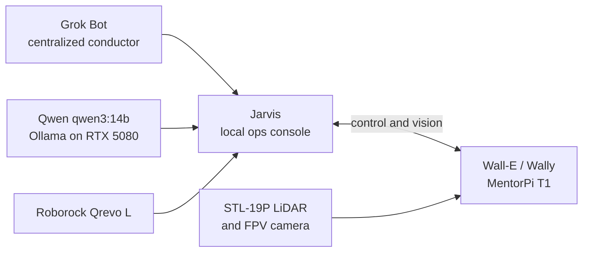

# Jarvis and Wall-E

John Gustafson's working notes for a tracked rover built with two kinds of AI at once: a centralized partner for design and diagnosis, and a local model that stays on the workbench.

The robot is **Wall-E** (Wally), a Hiwonder MentorPi. The console in front of it is **Jarvis**, on a salvaged workstation named **ALPHA-ONE**. This page is the project intro. The voice-stack source from November 5–7, 2026 is on GitHub. Most of what the screenshots show is running on the machines and is not in this repository yet.

## A hybrid way to build

Everyday AI tasks are one end of what these systems can do. This project explores the far end: a real tracked robot, live sensors, and a local command console.

**Grok Bot**, from the xAI team, acts as a centralized conductor for design, diagnosis, and iteration.

**Qwen** (`qwen3:14b`) runs locally through **Ollama** on ALPHA-ONE, a salvaged workstation with an RTX 5080. Putting the model there takes the heavy compute off the MentorPi, toward longer-term self-sufficiency: more of the rover's work can stay in the room.

Central and local AI working together is the practical pattern this project is testing.

## Hardware and stack

**Wall-E (Wally).** Hiwonder MentorPi T1 Advanced tracked rover. The host is a Raspberry Pi 5 with 16 GB of RAM. ROS 2 Humble runs in Docker under the name `MentorPi`. The ranging sensor is an LDROBOT STL-19P (D500) DTOF LiDAR.

**ALPHA-ONE.** Salvaged RTX 5080 workstation. Ollama serves `qwen3:14b` at about 45 tok/s, measured November 23, 2026. **Jarvis** (`D:\AI-Models\jarvis`) is the local ops console on that machine. It covers RTX 5080 and Ollama telemetry, Wall-E control and vision, and a panel for a Roborock Qrevo L.

## How the pieces connect



Grok Bot and Qwen both feed Jarvis. Jarvis and Wall-E exchange commands, the map, and the camera. The LiDAR and the FPV camera feed Wall-E. The Qrevo L reports into its own panel on Jarvis.

## Live from Jarvis

Both frames are from the same session: November 26, 2026, about 7:34 PM PT. Wall-E was armed in ground mode. Ollama was serving `qwen3:14b` on the RTX 5080. The vision column shows the live LiDAR map, the FPV camera, and an `rfdetr_nano` YOLO overlay at 10.9 FPS. The drive pad is the 3×3 diagonal pad, and the speed slider is at the manual cap of `0.288 m/s`.

The overlay in these frames is classifying incorrectly (a chair comes back as `tv`, part of the doorway as `remote`). It is scheduled to move to a stronger model, such as YOLOE or a detector trained on household classes. The same note is printed on the images.


*Full Jarvis dashboard on ALPHA-ONE, November 26, 2026, about 7:34 PM PT. Left: Ollama `qwen3:14b` on the RTX 5080, plus host telemetry. Center: Wall-E arm and mode controls, and the Roborock Qrevo L panel. Right: live LiDAR, FPV, the `rfdetr_nano` overlay at 10.9 FPS, the `0.288 m/s` slider, and the diagonal drive pad.*


*Wall-E Vision column from the same capture. Live LiDAR map, FPV camera, the same `rfdetr_nano` overlay at 10.9 FPS, Arm / Disarm, the `0.288 m/s` speed slider, and the 3×3 combined-axis diagonal D-pad.*

## Verified timeline

The split below is deliberate. November 5–7 is the voice foundation GitHub holds. The Jarvis console, the November 26 gate fixes, and the behavior in both screenshots are live on the Pi and on ALPHA-ONE, and that code is waiting for the next full sync. The pictures themselves are in this repository.

### November 5–7, 2026 — on GitHub

The repository was created on November 5 ([`69303d5`](https://github.com/CNY-Radar-Guy/mentorpi-voice-assistant/commit/69303d5dadc5b06dbbf47ce239c0098ffd0d471f)). On `main`, that commit is the license and a one-line README.

The voice-controlled rover foundation is also on GitHub, on [`cursor/publish-mentorpi-voice-8581`](https://github.com/CNY-Radar-Guy/mentorpi-voice-assistant/tree/cursor/publish-mentorpi-voice-8581), from [`70fb756`](https://github.com/CNY-Radar-Guy/mentorpi-voice-assistant/commit/70fb756464533bede5ba32156f006615ac101785) (November 5, "Publish the sanitized MentorPi voice assistant tree") through [`bb5bd86`](https://github.com/CNY-Radar-Guy/mentorpi-voice-assistant/commit/bb5bd864ac501750631947b7c1566ae12eaaa1e9) (November 7). It includes:

- `grokbot_voice.py`
- software wake: `wake up Wally`
- identity phrase: `I am John` (the voice code treats this as identity, not as a credential)
- WonderEcho hardware wake: `Hello Hiwonder` (the factory firmware phrase; this tree does not reflash that chip)

`main` does not contain that tree yet. Most work after November 7 is live on the Pi and on ALPHA-ONE, awaiting the next full code sync.

### November 7–23, 2026 — local on ALPHA-ONE and the Pi

- The local Qwen / Ollama stack was checked on the RTX 5080: `qwen3:14b`, about 45 tok/s on November 23.
- Jarvis, the local ops console, was started on ALPHA-ONE (`D:\AI-Models\jarvis`).
- The onboard safety gate was deployed to the Pi at release [`e48d3d8`](https://github.com/CNY-Radar-Guy/mentorpi-voice-assistant/commit/e48d3d8cf7c2e71d18f74fc2a80d54ee43864294) (November 7 on the publish branch). Stop distances are `0.27 m` front, `0.28 m` rear, and `0.24 m` sweep, with a `0.5 s` deadman. The gate uses Nav2-style slow, contact, and escape zones, and it distinguishes bench mode from ground mode.

Those stop distances and the deadman are in the published gate (`STOP_FWD` / `STOP_REV` / `SWEEP_R` in `gb_obstacle.py` on that branch). The speed split and the stall-latch fix below are local to the Pi.

### November 26, 2026 — local on Jarvis and the Pi

- Live LiDAR viewer on Jarvis.
- FPV plus a YOLO overlay, with click-to-label and auto-reconnect. The running model is `rfdetr_nano` at 10.9 FPS. The labels in the frames above are wrong, and the model is queued for a replacement (YOLOE, or custom household classes).
- A 3×3 combined-axis diagonal D-pad, keyboard combinations for the diagonals, and a fix so the speed slider keeps focus.
- Split speed caps. Manual drive has a hard cap of `0.288 m/s`. Autonomous explore has a hard cap of `1.0 m/s`, starts at a `0.1012 m/s` cruise, and may pick up speed in `0.10 m/s` steps only while the sensors still allow the step. Stop distances are unchanged.
- A stuck `"guard bump detected"` latch was diagnosed and fixed, then checked at 8:00 PM PT. During a LiDAR dropout the gate creeps at `0.04 m/s`. `STALL_MIN_CMD` was `0.03 m/s`, so that creep looked like a stall, and the trip file was never cleared. The fix calls `clear_trip()` on startup, on disarm, and after `2.0 s` idle, and raises `STALL_MIN_CMD` to `0.05 m/s`. The published tree still has `STALL_MIN_CMD = 0.03`.

## Limits and safety

Numbers in force on the Pi as of the November 26 evening check. Stop distances and the deadman were already in the November 7 release. The manual / explore speed split and the stall floor are local.

| Limit | Value | Notes |
| --- | --- | --- |
| Front stop | `0.27 m` | From the LiDAR centre, forward |
| Rear stop | `0.28 m` | Reverse |
| Sweep stop | `0.24 m` | Turn clearance |
| Deadman | `0.5 s` | A motion command has to keep refreshing |
| Zones | slow, contact, escape | Nav2-style, inside the gate |
| Mode | bench or ground | Bench is the stand; ground is the floor |
| Manual hard cap | `0.288 m/s` | Jarvis speed slider, November 26 |
| Explore hard cap | `1.0 m/s` | Autonomous explore only |
| Explore cruise | `0.1012 m/s` | Speed explore starts at |
| Pick-up step | `0.10 m/s` | Sensor-bounded; refused when the next step is not clear |
| Dropout creep | `0.04 m/s` | LiDAR-dropout speed that tripped the stall latch |
| `STALL_MIN_CMD` before | `0.03 m/s` | Published tree; the `0.04 m/s` creep counted as a stall |
| `STALL_MIN_CMD` after | `0.05 m/s` | Local fix, verified 8:00 PM PT on November 26 |
| Trip clear | startup, disarm, `2.0 s` idle | `clear_trip()`; the trip file no longer sticks across a stop |

## What's next

- Sync the post–November 7 Pi and Jarvis code into this repository. `main` and the November 7 branch both stop short of the console and the November 26 gate fixes.
- Replace `rfdetr_nano` with a stronger detector: YOLOE, or a model trained on household classes. The overlay in the November 26 frames mislabels ordinary room objects.
- A Wall-E charging dock beside the vacuum, with QR alignment and a log of battery cycles.
- Return-to-start that uses the LiDAR and the FPV camera together.
- An outdoor autonomous patrol rover: Jetson Orin, GPS/RTK, and a flight controller still to choose between Pixhawk and SpeedyBee.
- Raspberry Pi nodes at radar sites, linked over MeshCore.

## Technical Setup & Reference

Before this page, `main` held only the original README:

```markdown
# mentorpi-voice-assistant
Voice-controlled Hiwonder MentorPi tracked rover with Grok Bot as the onboard AI brain
```

The November 5–7 technical reference — kit notes, setup, the voice-stack architecture diagram, the wake-phrase table, and configuration — is the README on [`cursor/publish-mentorpi-voice-8581`](https://github.com/CNY-Radar-Guy/mentorpi-voice-assistant/blob/cursor/publish-mentorpi-voice-8581/README.md). Install steps for Jarvis, and for the Pi tree as it actually runs after November 7, belong with that code sync. They are not written here ahead of the tree.
